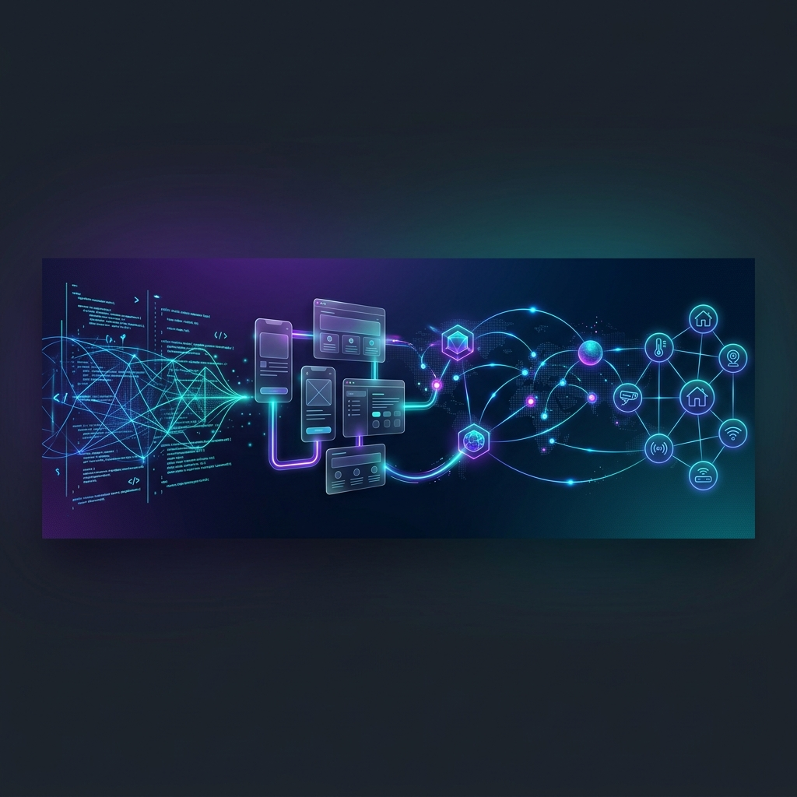

# 
👋 Hello World! / ¡Hola a todos! I'm Alejandro Wade

  

  <strong>Spanish-British Software Developer 🇪🇸 🇬🇧 | Flutter & Multiplatform Specialist | IoT & AI Enthusiast</strong>

  
  
  

---

## ⚡ About Me / Sobre Mí

<strong>🇬🇧 English Version</strong>

 
I am a dedicated **Multiplatform Software Developer (DAM)** with dual Spanish-British nationality, bringing a global perspective to software engineering. Recently returned from an international **Erasmus+ Software Development internship in Finland**, I thrive in dynamic, collaborative, and fast-paced environments where code meets real-world problem-solving.

My technical foundation spans across robust multiplatform frontends (**Flutter & Dart**), system programming (**Java & Python**), and physical computing (**IoT & smart sensor networks**). I am deeply driven by curiosity, constantly integrating cutting-edge **AI technologies** to optimize workflows and code performance.

*   🌍 **Dual Nationality:** Spanish & British (Native Bilingual ES / EN).
*   🚀 **Core Focus:** Building polished multiplatform apps, smart IoT systems, and automated AI workflows.
*   💪 **Philosophy:** Obstacles are opportunities to research, iterate, and adapt.

<strong>🇪🇸 Versión en Español</strong>

 
Soy un **Desarrollador de Software Multiplataforma (DAM)** comprometido y con doble nacionalidad hispano-británica, lo que me aporta una perspectiva global en la ingeniería de software. Tras completar recientemente unas prácticas internacionales de **Desarrollo de Software con la beca Erasmus+ en Finlandia**, me entusiasma trabajar en entornos dinámicos y colaborativos donde el código resuelva problemas reales de forma eficiente.

Mi base técnica se centra en frontends multiplataforma modernos y pulidos (**Flutter y Dart**), programación de sistemas y backend (**Java y Python**), y computación física (**IoT y redes de sensores inteligentes**). Me apasiona la innovación y la integración de **herramientas de Inteligencia Artificial** para optimizar el rendimiento y acelerar el desarrollo.

*   🌍 **Nacionalidad:** Española y Británica (Bilingüe Nativo ES / EN).
*   🚀 **Enfoque Principal:** Creación de aplicaciones móviles/web pulidas, sistemas IoT y automatizaciones con IA.
*   💪 **Filosofía:** Los retos de código son oportunidades para investigar, iterar y adaptarme sin rendirme.

---

## 🛠️ Tech Stack & Toolkit / Tecnologías

<table>
  <tr>
    <td valign="top" width="50%">
      <strong>🚀 Languages & Frameworks</strong>  
      
       
      
       
      
       
      
      
      
    </td>
    <td valign="top" width="50%">
      <strong>⚙️ Hardware, Tools & AI</strong>  
      
       
      
       
      
       
      
    </td>
  </tr>
</table>

---

## 📂 Featured Projects / Proyectos Destacados

### 🏫 ClassAssistant: IoT Space & Classroom Management
> **Stack:** Flutter, Dart, IoT Sensors (Arduino/ESP32), WebSockets, REST APIs.

*   **EN:** A comprehensive multiplatform solution (Mobile + Web) designed for smart management of environments. The system connects seamlessly to a physical IoT sensor network to monitor real-time environmental data (temp, humidity, light) and security parameters (doors/windows status), incorporating a secure remote-locking system for classrooms.
*   **ES:** Solución integral multiplataforma (App móvil y Web) para la administración inteligente de espacios y aulas. El sistema se conecta a una red física de sensores IoT para el monitoreo en tiempo real de variables ambientales (temperatura, humedad, luminosidad) y de seguridad, incluyendo control remoto de cerraduras inteligentes.

### ♿ DiverCity Park: Inclusive Accessibility & Geolocation App
> **Stack:** Ionic, Java, Google Maps API, SQLite / PostgreSQL.

*   **EN:** Mobile application focused on urban accessibility and social inclusion. Designed to assist individuals with reduced mobility in mapping, geolocalizing, and verifying the real-time availability of reserved parking spaces, featuring an accessible UI and integrated geolocation services.
*   **ES:** Aplicación móvil centrada en la accesibilidad urbana e inclusión social. Ayuda a personas con discapacidad a localizar, mapear y verificar la disponibilidad de plazas de aparcamiento reservadas, a través de una interfaz de alta accesibilidad y servicios de geolocalización.

### 🤖 Corporate Chatbot: AI Conversational Agent
> **Stack:** Python, AI Integration, Natural Language Processing.

*   **EN:** Designed and developed an intelligent conversational chatbot for corporate information. The agent autonomous parses user questions, accesses structured corporate databases, and serves precise, safe responses, streamlining internal business data workflows.
*   **ES:** Diseño y desarrollo de un chatbot conversacional enfocado en proporcionar información corporativa estructurada de forma inmediata, implementando lógica autónoma de preguntas y respuestas integradas en el flujo digital de la empresa.

---

## 💼 Professional Experience / Experiencia Profesional

*   **Desarrollador de Software (Beca Erasmus+)** @ *Casamedia KY* (Finland 🇫🇮, 2026)
    *   Designed multiplatform applications using **Flutter & Dart**, optimizing frontend performance.
    *   Maintained and improved custom ERP solutions (Odoo-like systems).
    *   Engineered and integrated autonomous chatbots in corporate environments.
*   **Programador (Prácticas)** @ *Lukap Informática* (Spain 🇪🇸, 2025)
    *   Developed web optimizations, boosting speed and project rendering performance.
    *   Researched and integrated state-of-the-art AI systems to streamline developer workflows.

---

## 🧠 The Developer's Mindset / Habilidades e Intereses

I believe that exceptional software engineering is fueled by diverse experiences. Here is how my personal passions directly strengthen my technical work:

*   🏀 **Basketball Coach (Head Coach):** Translates to **leadership, tactical planning, and effective communication**. Managing high-pressure situations on the court directly informs my approach to project coordination, agile workflows, and managing team dynamics under tight deadlines.
*   ♟️ **Chess Player:** Translates to **deep logical thinking, patience, and modular architecture**. In chess, you must anticipate several moves ahead; in development, this translates to writing maintainable, clean, and scalable code while foreseeing and debugging potential edge cases.
*   🏎️ **Sim Racing & Telemetry:** Translates to **system diagnostics, optimization, and attention to detail**. Analyzing real-time racing telemetries, fine-tuning hardware parameters, and solving mechanical setups map perfectly onto debugging complex IoT sensors, analyzing application performance data, and telemetry monitoring.

---

## 📊 My GitHub Stats / Estadísticas

  
  &nbsp;&nbsp;&nbsp;&nbsp;&nbsp;&nbsp;
  

---

  <strong>Let's connect and build something awesome together! / ¡Conectemos y construyamos algo increíble juntos!</strong> 
  Designed with 💻 and ☕ by Alejandro Wade

